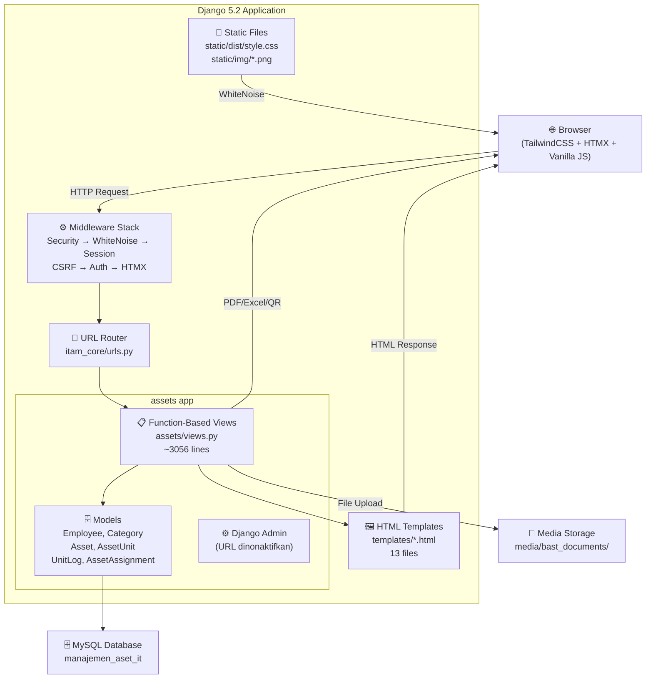

# 01 — System Overview: Arsitektur Sistem Manajemen Aset IT PT. KMH

**Tanggal Analisis:** 26 Oktober 2026  
**Status Verifikasi:** Analisis statis — arsitektur runtime belum diverifikasi

---

## 1. Tujuan Aplikasi (Berdasarkan Implementasi)

Berdasarkan pemeriksaan source code, aplikasi ini bertujuan untuk:

1. **Mencatat dan menginventarisasi aset IT** yang dimiliki PT. KMH (peralatan karyawan dan infrastruktur jaringan/network)
2. **Mengelola distribusi aset** — mencatat serah terima aset dari gudang ke karyawan, mutasi antar karyawan, dan pengembalian aset
3. **Memantau status fisik unit aset** — tersedia, sedang digunakan, dalam perbaikan/maintenance, atau dipensiunkan
4. **Menyimpan riwayat historis** setiap unit aset (audit trail) dari masuk sistem hingga pensiun
5. **Menghasilkan laporan** dalam format PDF dan Excel untuk semua modul
6. **Menyediakan identifikasi unit via QR Code** — setiap unit dapat di-scan untuk melihat informasi publiknya
7. **Mengelola data karyawan** sebagai penerima/penanggung jawab aset

---

## 2. Arsitektur Sistem

### 2.1 Jenis Arsitektur

Aplikasi ini adalah **monolithic web application** berbasis Django dengan pattern **Multi-Page Application (MPA)**:

- **Tidak ada REST API atau GraphQL** — semua komunikasi adalah server-rendered HTML
- **HTMX** digunakan untuk partial page updates (interaksi asinkron tanpa full page reload)
- **Satu Django app** (`assets`) menangani seluruh business logic
- **Satu project Django** (`itam_core`) sebagai konfigurasi inti

### 2.2 Lapisan Arsitektur

```
┌─────────────────────────────────────────────────┐
│                   Browser                        │
│         (TailwindCSS + HTMX + Vanilla JS)       │
└──────────────────────┬──────────────────────────┘
                       │ HTTP Request
┌──────────────────────▼──────────────────────────┐
│            Django WSGI Server                    │
│  ┌─────────────────────────────────────────────┐ │
│  │                Middleware Stack              │ │
│  │  SecurityMiddleware → WhiteNoiseMiddleware   │ │
│  │  → SessionMiddleware → CommonMiddleware      │ │
│  │  → CsrfViewMiddleware → AuthMiddleware       │ │
│  │  → MessageMiddleware → XFrameOptionsMiddleware│ │
│  │  → HtmxMiddleware                           │ │
│  └──────────────────┬──────────────────────────┘ │
│                     │                             │
│  ┌──────────────────▼──────────────────────────┐ │
│  │             URL Routing                      │ │
│  │          itam_core/urls.py                   │ │
│  └──────────────────┬──────────────────────────┘ │
│                     │                             │
│  ┌──────────────────▼──────────────────────────┐ │
│  │       Views (Function-Based Views)           │ │
│  │          assets/views.py (3056 baris)        │ │
│  └──────┬──────────────────────────┬────────────┘ │
│         │                          │               │
│  ┌──────▼──────┐          ┌────────▼──────────┐   │
│  │   ORM/Models│          │   Templates        │   │
│  │ assets/     │          │ templates/*.html   │   │
│  │ models.py   │          └───────────────────┘   │
│  └──────┬──────┘                                   │
└─────────┼───────────────────────────────────────┘
          │
┌─────────▼──────────────────────────────────────┐
│              MySQL Database                      │
│    (django.db.backends.mysql via PyMySQL)        │
└──────────────────────────────────────────────────┘
```

---

## 3. Komponen Utama

### 3.1 Backend

| Komponen | File | Peran |
|---|---|---|
| Django Project | `itam_core/` | Konfigurasi inti, URL routing global, WSGI/ASGI entrypoint |
| Django App | `assets/` | Satu-satunya app, menampung semua business logic |
| Models | `assets/models.py` | Definisi 5 model: Employee, Category, Asset, AssetUnit, UnitLog, AssetAssignment |
| Views | `assets/views.py` | 3056 baris — seluruh business logic dan response rendering |
| Admin | `assets/admin.py` | Registrasi model ke Django Admin (URL admin dinonaktifkan) |
| Management Commands | `assets/management/commands/` | `seed_initial_data.py`, `setup_superuser.py` |
| Migrations | `assets/migrations/` | 16 file migrasi, evolusi skema dari awal hingga kini |

### 3.2 Frontend

| Komponen | File/Directory | Peran |
|---|---|---|
| Templates | `templates/*.html` | 13 template HTML |
| Base Layout | `templates/base.html` | Layout utama: sidebar, topbar, toast notification, guide modal |
| CSS Framework | TailwindCSS 3.4.19 | Styling utility-first |
| JS Interactivity | HTMX 2.0.11 | Partial page updates (form submission, modal, dll) |
| Build System | Vite 5.4.21 | Bundle frontend assets |
| Frontend Source | `frontend/main.js`, `frontend/style.css` | Source sebelum di-build |
| Compiled CSS | `static/dist/style.css` | CSS yang sudah dikompilasi (committed ke repo) |

### 3.3 Static Files

| Direktori | Konten |
|---|---|
| `static/dist/` | CSS yang sudah dikompilasi oleh Tailwind/Vite |
| `static/img/` | Logo perusahaan (kerinci_logo.png, it_all_role_logo.png, dll) |

### 3.4 Media Files

| Path | Konten |
|---|---|
| `media/bast_documents/` | Upload dokumen BAST (Berita Acara Serah Terima) — runtime directory |

---

## 4. Diagram Arsitektur (Mermaid)



---

## 5. Alur Request dari Browser ke Database

### 5.1 Alur Standar (GET request halaman)

```
1. Browser → GET /aset/
2. Django Middleware Stack (security checks, session, auth check)
3. URL Router mencocokkan pattern → asset_list view
4. @login_required → redirect ke /login/ jika tidak terautentikasi
5. View: Asset.objects.annotate().filter().order_by()
6. MySQL mengembalikan queryset
7. View merender template asset_list.html dengan context
8. Template engine render HTML
9. HTML response → Browser
```

### 5.2 Alur Form Submit (POST request dengan HTMX)

```
1. Browser → POST /aset/add/ (dengan HTMX atau form biasa)
2. Middleware: CSRF token validation
3. URL Router → asset_add view
4. View: request.method == 'POST' check
5. Ekstrak data dari request.POST
6. Validasi (duplikasi kode, dll)
7. Asset.objects.create(...)
8. MySQL INSERT
9. messages.success() → tambah ke session
10. JsonResponse({'success': True}) atau redirect
11. Browser: HTMX/JS menangani respons (tutup modal, refresh tabel, show toast)
```

### 5.3 Alur Export PDF

```
1. Browser → GET /aset/export/?tab=karyawan
2. @login_required check
3. View query data dari MySQL
4. ReportLab membangun PDF di memory (BytesIO)
5. HttpResponse dengan content_type='application/pdf'
6. Browser menampilkan/mengunduh PDF
```

---

## 6. Template Hierarchy

```
base.html (layout utama: sidebar, topbar, toast, guide modal)
├── login.html (tidak extends base — standalone)
├── dashboard.html
├── asset_list.html
├── asset_units.html
├── status_aset_list.html
├── distribusi_list.html
├── employee_list.html
├── employee_detail.html
├── unit_history.html
├── unit_public_detail.html (tidak extends base — halaman publik)
├── backup.html
├── profile.html
└── 404.html (tidak extends base)
```

---

## 7. Integrasi Eksternal

| Integrasi | Tipe | Detail |
|---|---|---|
| Google Fonts | CDN eksternal | Font "Inter" dimuat dari `fonts.googleapis.com` (`base.html` L9) |
| MySQL Server | Database | Server MySQL lokal/remote via PyMySQL |
| Media storage | Filesystem lokal | Upload dokumen disimpan di `media/bast_documents/` |

> [!NOTE]
> Tidak ditemukan integrasi dengan layanan cloud, email provider, message queue, atau external API. Semua operasi bersifat self-contained.

---

## 8. Konfigurasi Keamanan

| Setting | Development | Production |
|---|---|---|
| `DEBUG` | `True` (dari env) | `False` |
| `SECRET_KEY` | Dari env, fallback `'django-insecure-dev-key-change-in-production'` | Dari env |
| `ALLOWED_HOSTS` | Dari env (split by comma) | Dari env |
| `SECURE_SSL_REDIRECT` | Tidak aktif | Optional (dari env) |
| `SECURE_HSTS_SECONDS` | Tidak aktif | 31536000 (1 tahun) |
| `SESSION_COOKIE_SECURE` | Tidak aktif | `True` |
| `CSRF_COOKIE_SECURE` | Tidak aktif | `True` |
| `SECURE_CONTENT_TYPE_NOSNIFF` | Tidak aktif | `True` |

---

## 9. Batas Sistem

Sistem ini **tidak menangani**:
- Manajemen lisensi software
- Kontrak vendor/supplier
- Pengadaan/procurement aset
- Garansi aset
- Manajemen tiket/insiden IT
- Notifikasi email atau push notification
- Integrasi dengan HRIS atau sistem ERP lainnya
- Multi-tenant atau multi-departemen dengan akses berbeda
- Peminjaman aset (borrow/return dengan tenggat waktu)
- Audit fisik (stock opname)

---

## 10. Asumsi dan Keterbatasan Analisis

| Asumsi | Dasar |
|---|---|
| Python versi ≥ 3.10 | Django 5.2 memerlukan Python 3.10+ |
| MySQL versi ≥ 5.7 atau 8.x | PyMySQL 1.2.3 mendukung keduanya |
| Server berjalan di Linux | Indikasi dari path dan konfigurasi |
| Single user (admin) | Tidak ada implementasi multi-role |

**Keterbatasan analisis:**
- Tidak ada runtime testing — perilaku aktual belum dikonfirmasi
- JavaScript di templates belum dianalisis sepenuhnya
- File `scratch_fix_views2.py` tidak dianalisis secara mendalam (kode development)
- `database_lokal.sql` tidak dibuka untuk menjaga privasi data
