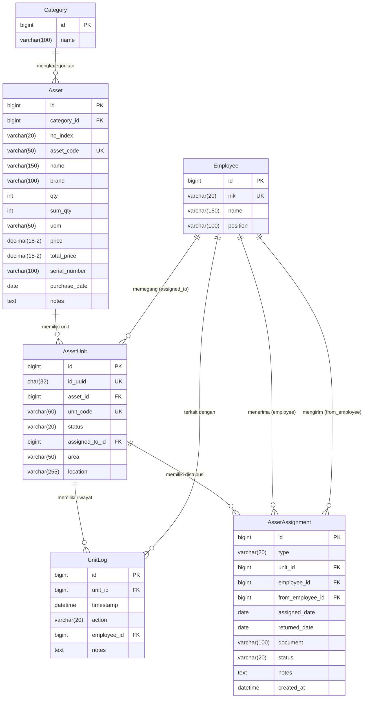

# 04 — Database & Data Dictionary: Model dan Skema Database

**Tanggal Analisis:** 26 Oktober 2026  
**Sumber:** `assets/models.py`, `assets/migrations/0001_initial.py` — `0016_sync_existing_unit_codes.py`  
**Status:** Terverifikasi dari source code — struktur aktual database hanya dapat dipastikan dengan akses runtime

---

## 1. Daftar Model

| Model | Tabel (estimasi) | Baris Definisi | Deskripsi |
|---|---|---|---|
| `Employee` | `assets_employee` | L4-10 | Data karyawan/pengguna aset |
| `Category` | `assets_category` | L12-16 | Kategori jenis aset |
| `Asset` | `assets_asset` | L18-82 | Jenis/tipe aset (SKU-level) |
| `AssetUnit` | `assets_assetunit` | L84-116 | Unit fisik individual |
| `UnitLog` | `assets_unitlog` | L118-141 | Riwayat historis setiap unit |
| `AssetAssignment` | `assets_assetassignment` | L143-168 | Riwayat distribusi aset |

---

## 2. Data Dictionary

### 2.1 Model: `Employee`

**Tujuan:** Menyimpan data karyawan yang dapat menerima/memegang aset IT

| Field | Tipe Django | Tipe DB (est.) | Nullable | Unique | Default | Keterangan |
|---|---|---|---|---|---|---|
| `id` | `BigAutoField` | `BIGINT` | No | Yes (PK) | Auto | Primary key otomatis |
| `nik` | `CharField(20)` | `VARCHAR(20)` | No | Yes | — | Nomor Induk Karyawan |
| `name` | `CharField(150)` | `VARCHAR(150)` | No | No | — | Nama lengkap karyawan |
| `position` | `CharField(100)` | `VARCHAR(100)` | Yes | No | None | Jabatan (ditambah di migration 0014) |

**Constraints:**
- `nik` adalah unique — duplikasi NIK dicegah di level model

**Methods:** `__str__` → `"{nik} - {name}"`

**Relasi:**
- `AssetUnit.assigned_to` → FK ke Employee (SET_NULL)
- `UnitLog.employee` → FK ke Employee (SET_NULL)
- `AssetAssignment.employee` → FK ke Employee (SET_NULL)
- `AssetAssignment.from_employee` → FK ke Employee (SET_NULL)

---

### 2.2 Model: `Category`

**Tujuan:** Klasifikasi jenis aset (minimal dua: "Aset Karyawan" dan "Aset Network")

| Field | Tipe Django | Tipe DB (est.) | Nullable | Unique | Default | Keterangan |
|---|---|---|---|---|---|---|
| `id` | `BigAutoField` | `BIGINT` | No | Yes (PK) | Auto | Primary key otomatis |
| `name` | `CharField(100)` | `VARCHAR(100)` | No | No | — | Nama kategori |

> [!NOTE]
> Seed data di `seed_initial_data.py` membuat dua kategori default: `'Aset Karyawan'` dan `'Aset Network'`. Aplikasi menggunakan `__icontains` untuk membedakan, bukan relasi eksplisit.

---

### 2.3 Model: `Asset`

**Tujuan:** Merepresentasikan jenis/tipe aset (SKU-level). Satu Asset bisa memiliki banyak AssetUnit.

| Field | Tipe Django | Tipe DB (est.) | Nullable | Unique | Default | Keterangan |
|---|---|---|---|---|---|---|
| `id` | `BigAutoField` | `BIGINT` | No | Yes (PK) | Auto | Primary key |
| `category` | `ForeignKey(Category)` | `BIGINT` (FK) | Yes | No | — | Kategori aset, SET_NULL jika kategori dihapus |
| `no_index` | `CharField(20)` | `VARCHAR(20)` | Yes | No | None | Nomor urut manual (tidak digenerate otomatis) |
| `asset_code` | `CharField(50)` | `VARCHAR(50)` | No | Yes | — | Kode unik aset, uppercase |
| `name` | `CharField(150)` | `VARCHAR(150)` | No | No | — | Nama aset |
| `brand` | `CharField(100)` | `VARCHAR(100)` | Yes | No | None | Merek/brand |
| `qty` | `IntegerField` | `INT` | No | No | 0 | Jumlah unit yang tercatat |
| `sum_qty` | `IntegerField` | `INT` | No | No | 0 | Tidak jelas digunakan untuk apa (field tidak di-update di kode) |
| `uom` | `CharField(50)` | `VARCHAR(50)` | Yes | No | None | Satuan unit (Unit, Pcs, dll) |
| `price` | `DecimalField(15,2)` | `DECIMAL(15,2)` | No | No | 0 | Harga satuan |
| `total_price` | `DecimalField(15,2)` | `DECIMAL(15,2)` | No | No | 0 | Total harga (tidak otomatis dihitung) |
| `serial_number` | `CharField(100)` | `VARCHAR(100)` | Yes | No | None | Serial number aset induk |
| `purchase_date` | `DateField` | `DATE` | Yes | No | None | Tanggal pembelian |
| `notes` | `TextField` | `TEXT` | Yes | No | None | Catatan tambahan |

**Potensi Masalah:**
- `qty` diupdate manual (`asset.qty = asset.units.count()`) hanya pada beberapa kondisi — tidak konsisten
- `sum_qty`, `price`, `total_price` — tampaknya tidak di-update oleh views yang ada. Kemungkinan field legacy
- `serial_number` di level Asset (bukan unit) — pada aplikasi ini, SN mungkin lebih relevan di level unit
- Tidak ada `created_at` atau `updated_at` pada model ini

**Custom `save()` method:**
- Mendeteksi jika `asset_code` berubah
- Jika berubah, otomatis mengupdate `unit_code` semua unit anak (L39-82)
- Menggunakan `transaction.atomic()` untuk atomisitas

---

### 2.4 Model: `AssetUnit`

**Tujuan:** Unit fisik individual. Satu unit = satu perangkat nyata dengan kode unik.

| Field | Tipe Django | Tipe DB (est.) | Nullable | Unique | Default | Keterangan |
|---|---|---|---|---|---|---|
| `id` | `BigAutoField` | `BIGINT` | No | Yes (PK) | Auto | Primary key integer |
| `id_uuid` | `UUIDField` | `CHAR(32)` | No | Yes | `uuid4()` | UUID untuk URL publik dan QR code |
| `asset` | `ForeignKey(Asset)` | `BIGINT` (FK) | No | No | — | Aset induk, CASCADE jika asset dihapus |
| `unit_code` | `CharField(60)` | `VARCHAR(60)` | No | Yes | — | Kode unik unit (format: `{asset_code}-{suffix}`) |
| `status` | `CharField(20)` | `VARCHAR(20)` | No | No | `'tersedia'` | Status unit |
| `assigned_to` | `ForeignKey(Employee)` | `BIGINT` (FK) | Yes | No | None | Pemegang saat ini, SET_NULL jika employee dihapus |
| `area` | `CharField(50)` | `VARCHAR(50)` | Yes | No | None | Area pemasangan (untuk aset network) |
| `location` | `CharField(255)` | `VARCHAR(255)` | Yes | No | None | Lokasi spesifik |

**STATUS_CHOICES:**
| Value | Label |
|---|---|
| `tersedia` | Tersedia |
| `digunakan` | Digunakan |
| `rusak` | Diperbaiki (label mismatch — value "rusak" tapi label "Diperbaiki") |
| `pensiun` | Dipensiunkan |

**AREA_CHOICES (hardcoded, domain spesifik PT. KMH):**
- Regulating Weir (RW), Jakon, Beringin Tunggal (BT), DAM, Adit 1/2/3, Gudang Induk (GI), Vertical Shaft (VS), Power House (PH), Lain-lainnya

> [!WARNING]
> **Status mismatch:** Field `status` memiliki value `'rusak'` tetapi label `'Diperbaiki'`. Di views, status ini diperlakukan sebagai "maintenance". Inkonsistensi antara value dan label dapat membingungkan developer.

---

### 2.5 Model: `UnitLog`

**Tujuan:** Audit trail setiap unit aset — mencatat semua perubahan status dan kejadian.

| Field | Tipe Django | Tipe DB (est.) | Nullable | Unique | Default | Keterangan |
|---|---|---|---|---|---|---|
| `id` | `BigAutoField` | `BIGINT` | No | Yes (PK) | Auto | Primary key |
| `unit` | `ForeignKey(AssetUnit)` | `BIGINT` (FK) | No | No | — | Unit terkait, CASCADE jika unit dihapus |
| `timestamp` | `DateTimeField(auto_now_add=True)` | `DATETIME` | No | No | Now | Waktu kejadian (otomatis) |
| `action` | `CharField(20)` | `VARCHAR(20)` | No | No | — | Jenis kejadian (choices) |
| `employee` | `ForeignKey(Employee)` | `BIGINT` (FK) | Yes | No | None | Karyawan terkait, SET_NULL |
| `notes` | `TextField` | `TEXT` | Yes | No | None | Catatan detail |

**ACTION_CHOICES:**
| Value | Label |
|---|---|
| `created` | Ditambahkan ke Sistem |
| `assigned` | Diserahkan kepada Karyawan |
| `returned` | Dikembalikan |
| `maintenance_in` | Masuk Perbaikan |
| `maintenance_out` | Selesai Perbaikan |
| `mutation` | Pindah User |
| `retired` | Dipensiunkan |
| `other` | Lain-lain |

**Meta:**
- `ordering = ['-timestamp']` — terbaru di atas

**Catatan Penting:**
- Ketika `employee` dihapus, nama karyawan di-embed ke dalam `notes` sebelum deletion (mekanisme `employee_delete` di views.py L792-796)
- Pattern parsing: `"{name} ({nik}) - {catatan}"` — parsing dilakukan dengan regex di view dan export

---

### 2.6 Model: `AssetAssignment`

**Tujuan:** Riwayat formal distribusi aset — serah terima, mutasi, pengembalian. Berbeda dengan UnitLog, ini adalah record formal dengan dokumen.

| Field | Tipe Django | Tipe DB (est.) | Nullable | Unique | Default | Keterangan |
|---|---|---|---|---|---|---|
| `id` | `BigAutoField` | `BIGINT` | No | Yes (PK) | Auto | Primary key |
| `type` | `CharField(20)` | `VARCHAR(20)` | No | No | `'handover'` | Tipe distribusi |
| `unit` | `ForeignKey(AssetUnit)` | `BIGINT` (FK) | No | No | — | Unit terkait, **PROTECT** — tidak bisa dihapus jika ada assignment |
| `employee` | `ForeignKey(Employee)` | `BIGINT` (FK) | Yes | No | None | Penerima, SET_NULL |
| `from_employee` | `ForeignKey(Employee)` | `BIGINT` (FK) | Yes | No | None | Pengirim (untuk mutasi), SET_NULL |
| `assigned_date` | `DateField` | `DATE` | No | No | — | Tanggal transaksi |
| `returned_date` | `DateField` | `DATE` | Yes | No | None | Tanggal dikembalikan (tidak di-update secara konsisten) |
| `document` | `FileField` | `VARCHAR(100)` | Yes | No | None | Path file dokumen BAST |
| `status` | `CharField(20)` | `VARCHAR(20)` | No | No | `'aktif'` | Status penugasan |
| `notes` | `TextField` | `TEXT` | Yes | No | None | Catatan tambahan |
| `created_at` | `DateTimeField(auto_now_add=True)` | `DATETIME` | Yes | No | Now | Waktu dibuat (ditambah di migration 0015) |

**TYPE_CHOICES:**
| Value | Label |
|---|---|
| `handover` | Serah Terima |
| `mutation` | Mutasi |
| `return` | Pengembalian |

**STATUS_CHOICES:**
| Value | Label |
|---|---|
| `aktif` | Aktif |
| `dikembalikan` | Dikembalikan |

> [!WARNING]
> `returned_date` tidak di-update secara otomatis ketika proses pengembalian (`distribusi_return`) dilakukan. Ini adalah inkonsistensi — field ada tapi tidak digunakan.

**Potensi masalah:**
- `status` field di `AssetAssignment` tidak di-update saat distribusi return — semua record tetap `'aktif'`
- `unit` menggunakan `PROTECT` — mencegah penghapusan unit jika ada assignment

---

## 3. Entity Relationship Diagram (ERD)

---

## 4. Migration Overview

| Migration | Perubahan Utama | Tanggal (dari kode) |
|---|---|---|
| `0001_initial.py` | Create: Category, Employee, Asset (dengan status), AssetAssignment | 2026-10-06 |
| `0002` | Tambah: `no_index`, `price`, `qty`, `sum_qty` ke Asset; tambah `AssetUnit` | — |
| `0003` | Remove: `status` dari Asset; hapus field lama; restrukturisasi model | — |
| `0004` | Create: `UnitLog` model | — |
| `0005` | Tambah: `brand` ke Asset; alter beberapa field | — |
| `0006` | Create: `MasterAssetCode` (kemudian dihapus) | — |
| `0007` | Delete: `MasterAssetCode` | — |
| `0008` | Remove: `label` dari AssetUnit; alter `UnitLog.action` choices | — |
| `0009` | Tambah: `from_employee`, `type` ke AssetAssignment | — |
| `0010` | Tambah: `area`, `location` ke AssetUnit | — |
| `0011` | Tambah: `id_uuid` ke AssetUnit | — |
| `0012` | Alter: `id_uuid` ke UUID type yang benar | — |
| `0013` | Alter: FK AssetAssignment (ubah CASCADE ke SET_NULL/PROTECT) | — |
| `0014` | Tambah: `position` ke Employee | — |
| `0015` | Tambah: `created_at` ke AssetAssignment | — |
| `0016` | RunPython: Sinkronisasi unit_code dengan asset_code induk | 2026-10-13 |

> [!NOTE]
> Adanya migration `0006` (create MasterAssetCode) diikuti `0007` (delete MasterAssetCode) menunjukkan ada eksperimen desain yang ditinggalkan. Field ini kemungkinan digantikan dengan `asset_code` yang ada di `Asset`.

---

## 5. Potensi Masalah Database

| # | Masalah | Lokasi | Dampak | Rekomendasi |
|---|---|---|---|---|
| DB-01 | `qty` tidak sinkron otomatis | `Asset.qty`, views.py | Angka `qty` di Asset bisa tidak akurat | Gunakan annotate dari unit count, bukan field tersimpan |
| DB-02 | `sum_qty`, `price`, `total_price` tidak diisi | `Asset` model | Field tidak berguna, membuang ruang | Audit penggunaan atau hapus jika tidak diperlukan |
| DB-03 | `returned_date` tidak diisi | `AssetAssignment` | Field tidak berfungsi | Update saat proses return |
| DB-04 | `AssetAssignment.status` tidak diupdate | views.py | Semua assignment berstatus 'aktif' meskipun sudah dikembalikan | Update status saat return |
| DB-05 | Status value mismatch di AssetUnit | models.py L89 | `'rusak'` → label `'Diperbaiki'` membingungkan | Ganti value ke `'maintenance'` atau sesuaikan label |
| DB-06 | Tidak ada soft delete | Semua model | Data yang dihapus tidak bisa dipulihkan | Pertimbangkan soft delete untuk Employee dan Asset |
| DB-07 | Tidak ada `created_at`/`updated_at` di Asset, Employee, Category, AssetUnit | — | Tidak bisa audit kapan data dibuat/diubah | Tambahkan audit fields |
| DB-08 | No index pada field pencarian umum | AssetUnit.status, Employee.name | Potensi slow query pada data besar | Tambahkan db_index=True |
| DB-09 | ON DELETE PROTECT pada AssetUnit→AssetAssignment | AssetAssignment.unit | Delete unit akan error jika ada assignment | By design, tapi perlu handling error yang baik di view |
| DB-10 | Employee deletion hardcode embed nama ke UnitLog.notes | views.py L792-796 | Parsing fragile, regex-based | Pertimbangkan soft delete atau arsip employee |
