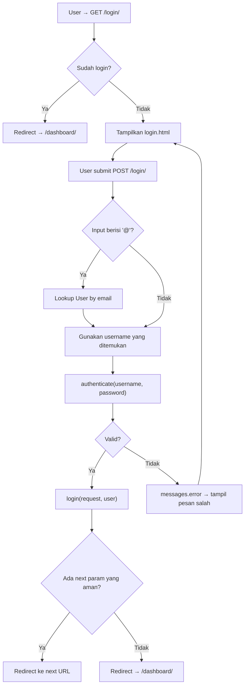

# 05 — Roles, Permissions & Authentication

**Tanggal Analisis:** 26 Oktober 2026  
**Sumber:** `assets/views.py`, `itam_core/settings.py`, `itam_core/urls.py`, `templates/base.html`  
**Status:** Terverifikasi dari source code

---

## 1. Authentication Flow

### 1.1 Login



**Fitur login:**
- Login via username ATAU email (L2452-2458 di `login_view`)
- Redirect ke URL `next` yang aman setelah login (menggunakan `url_has_allowed_host_and_scheme`)
- Jika sudah login, redirect ke dashboard

### 1.2 Logout

- Hanya via POST (`logout_view` L2473-2476)
- CSRF token diperlukan (form di base.html mengandung CSRF token)
- Redirect ke `/login/` setelah logout

### 1.3 Django Session

- Session disimpan di database Django (default `django.contrib.sessions.SessionStore`)
- `SESSION_COOKIE_SECURE = True` di production (DEBUG=False)

---

## 2. Authorization Model

### 2.1 Model Authorization yang Digunakan

| Mekanisme | Digunakan? | Detail |
|---|---|---|
| `@login_required` decorator | Ya | Hampir semua view menggunakannya |
| Django Groups | Tidak ditemukan implementasi | INSTALLED_APPS include `auth`, tapi tidak ada grup |
| Django Permissions | Tidak ditemukan | Tidak ada `has_perm()` atau `permission_required` |
| Object-level permissions | Tidak ada | Tidak ada django-guardian atau similar |
| Custom middleware | Tidak ada | Hanya middleware bawaan |
| Role-based access | Tidak ada | Satu level: authenticated = akses penuh |

### 2.2 Satu-satunya Pembatasan Akses Khusus

**Backup Database** — hanya `is_superuser` yang dapat mengakses:

```python
# assets/views.py L2538-2540
if not request.user.is_superuser:
    return HttpResponseForbidden("Anda tidak memiliki akses ke halaman ini.")
```

Ini adalah **satu-satunya** pembatasan akses berbasis role yang ditemukan di seluruh aplikasi.

---

## 3. Role yang Teridentifikasi

| Role | Deskripsi | Akses | Bukti | Status |
|---|---|---|---|---|
| **Anonymous** | Belum login | Hanya: `/login/`, `/public/unit/{uuid}/`, `/qr/{uuid}/` | URL patterns | Terverifikasi |
| **Authenticated User** | User Django yang sudah login | Hampir semua fitur kecuali backup SQL | `@login_required` di views | Terverifikasi |
| **Superuser** | `is_superuser=True` | Semua fitur termasuk backup database | `backup_database_view` check L2538 | Terverifikasi |

> [!WARNING]
> **Tidak ada diferensiasi role** dalam praktiknya. Jika ada 2 user yang login, keduanya memiliki akses yang sama ke semua fitur kecuali backup. Tidak ada "read-only" user, tidak ada role "supervisor" atau "viewer".

---

## 4. Permission Matrix per Fitur

| Fitur | Anonymous | Authenticated | Superuser | Catatan |
|---|---|---|---|---|
| Login | ✅ | ↩️ Redirect | ↩️ Redirect | — |
| Logout | ❌ | ✅ | ✅ | — |
| Dashboard | ❌ | ✅ | ✅ | — |
| Daftar Aset | ❌ | ✅ | ✅ | — |
| **Tambah Aset** | **✅ PUBLIK!** | ✅ | ✅ | **BUG: tidak ada @login_required** |
| Edit Aset | ❌ | ✅ | ✅ | — |
| Hapus Aset | ❌ | ✅ | ✅ | — |
| Export Aset | ❌ | ✅ | ✅ | Anomali double decorator |
| Unit Aset | ❌ | ✅ | ✅ | — |
| Tambah Unit | ❌ | ✅ | ✅ | — |
| Edit Unit | ❌ | ✅ | ✅ | — |
| Hapus Unit | N/A | N/A | N/A | URL tidak terdaftar |
| Status Aset | ❌ | ✅ | ✅ | — |
| Distribusi | ❌ | ✅ | ✅ | — |
| Data Karyawan | ❌ | ✅ | ✅ | — |
| QR Code | ✅ | ✅ | ✅ | By design — untuk scan publik |
| Halaman Publik Unit | ✅ | ✅ | ✅ | By design — untuk scan QR |
| Backup JSON | ❌ | ✅* | ✅ | *Authenticated non-superuser bisa akses (tidak ada superuser check) |
| **Backup SQL** | ❌ | ❌ Forbidden | ✅ | Satu-satunya pembatasan khusus |
| Profil | ❌ | ✅ | ✅ | — |
| Django Admin | Varies | Staff only | ✅ | **URL dikomentari di urls.py** |

> [!CAUTION]
> **Backup JSON (dumpdata)** dapat diakses oleh semua authenticated user (bukan hanya superuser). Ini dapat mengekspos seluruh data database kepada operator biasa jika ada multi-user di masa depan.

---

## 5. Security Findings terkait Auth

| Finding | Lokasi | Severity | Detail |
|---|---|---|---|
| `asset_add` tanpa `@login_required` | `views.py` L192 | High | Siapapun bisa tambah aset |
| `unit_qr_code` tanpa `@login_required` | `views.py` L804 | Info | Disengaja — QR perlu diakses publik |
| `unit_public_detail` tanpa `@login_required` | `views.py` L847 | Info | Disengaja — halaman publik untuk QR |
| `backup_database_view` hanya check superuser untuk SQL | `views.py` L2538 | Medium | JSON backup tidak dilindungi sama ketatnya |
| Double `@login_required` di baris 84-86 | `views.py` L84-86 | Low | Kode anomali, tapi tidak merusak security |
| `login_view` tidak ada rate limiting | `views.py` L2442 | Medium | Brute-force login tidak dicegah |
| Django Admin dinonaktifkan di URL | `urls.py` L20 | Info | `path('admin/', ...)` dikomentari |

---

## 6. Password Management

| Aspek | Implementasi | Status |
|---|---|---|
| Password hashing | Django default (PBKDF2-SHA256) | ✅ Aman |
| Password validators | 4 validator aktif (similarity, length, common, numeric) | ✅ |
| Ganti password | Verifikasi password lama dulu | ✅ |
| Session update setelah ganti password | `update_session_auth_hash` dipanggil | ✅ |
| Password reset via email | Tidak ditemukan | ❌ Missing |
| Password via env | `setup_superuser.py` membaca dari env | ✅ |

---

## 7. Bagian yang Belum Dapat Diverifikasi

| Aspek | Status | Langkah Verifikasi |
|---|---|---|
| Apakah ada lebih dari satu Django user di production | Belum diketahui | Periksa database `auth_user` |
| Konfigurasi session expire time | Belum diketahui | Cek settings untuk `SESSION_COOKIE_AGE` (tidak ditemukan, default Django = 2 minggu) |
| Apakah Django Admin pernah digunakan sebelumnya | Indikasi ya (terdaftar di admin.py) | Periksa apakah ada data di `django_admin_log` |
| Mekanisme recovery jika password superuser terlupa | Belum terverifikasi | Cek apakah `setup_superuser.py` ada di deployment runbook |
