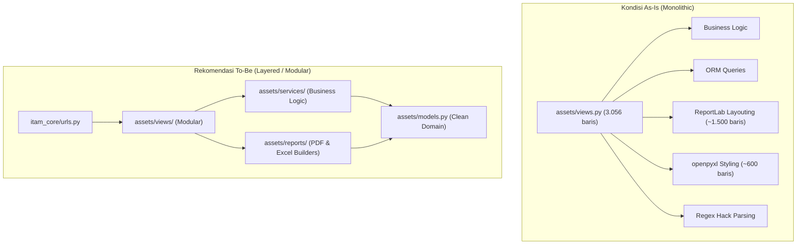

# 08 — Code Quality & Maintainability Audit

**Tanggal Analisis:** 26 Oktober 2026  
**Sumber Bukti:** `assets/views.py` (3.056 baris), `assets/models.py`, `itam_core/settings.py`  
**Status Verifikasi:** Terverifikasi via code inspection statis  

---

## 1. Ringkasan Kualitas Kode & Maintainability

| Aspek | Penilaian | Tingkat Keparahan / Bukti |
|---|---|---|
| **Struktur Modularitas** | Rendah (God File / Monolith) | `views.py` memiliki 3.056 baris tanpa sub-modul |
| **Separation of Concerns** | Rendah | View memproses HTTP, query ORM rumit, validasi, PDF layouting ReportLab, dan styling Excel sekaligus |
| **Duplikasi Kode (DRY)** | Sangat Tinggi | Kode pembuatan dokumen ReportLab dan openpyxl disalin berulang kali |
| **Penanganan Error** | Kurang Konsisten | Banyak blok `try-except` yang menangkap `Exception` generik dan melakukan silent pass (`pass`) |
| **Type Annotations** | Tidak Ada | Tidak ditemukan type hinting (`typing`) di fungsi maupun model |
| **Pengujian Otomatis** | Kosong (0% Coverage) | `assets/tests.py` hanya 4 baris placeholder bawaan Django |
| **Logging Sistem** | Parsial | Konfigurasi logging ada di `settings.py`, tetapi logging terstruktur tidak dipakai di business logic |
| **Technical Debt** | Tinggi | Terakumulasi di penanganan data yang terhapus dan query yang berpotensi N+1 |

---

## 2. Temuan Kritis & Analisis Masalah

### CQ-01: Masalah "God File" pada `assets/views.py`
- **Lokasi:** `assets/views.py` (Baris 1 s/d 3056)
- **Tingkat Keparahan:** High
- **Deskripsi:** Seluruh fungsi tampilan (dashboard, aset, unit, distribusi, karyawan, generate QR, PDF export, Excel export, backup) ditempatkan dalam satu file tunggal berukuran >130 KB.
- **Dampak:** 
  1. Sangat rentan menimbulkan merge conflict saat dikerjakan oleh lebih dari satu developer.
  2. Sulit melakukan penelusuran regresi atau isolasi unit testing.
  3. Memperlambat proses review kode dan navigasi IDE.
- **Rekomendasi:** Pecah direktori `assets/views/` menjadi beberapa package:
  - `views/dashboard.py`
  - `views/asset.py` (Master Aset & Unit)
  - `views/distribution.py` (Handover, Mutation, Return)
  - `views/employee.py`
  - `views/export_pdf.py` & `views/export_excel.py`
  - `views/auth.py` & `views/backup.py`

---

### CQ-02: Duplikasi Kode Ekstrem pada Modul Pelaporan (ReportLab & openpyxl)
- **Lokasi:** `assets/views.py` (L857-2440 dan L2598-3056)
- **Tingkat Keparahan:** High
- **Bukti Teknis:**
  Setiap view export PDF (misal `asset_export_pdf`, `distribusi_export_pdf`, `status_aset_export_pdf`, `employee_export_pdf`, `employee_detail_export_pdf`, `unit_history_export_pdf`, `asset_units_export_pdf`) menduplikasi:
  1. Definisi palette warna:
     ```python
     navy = HexColor('#002060')
     alt_row = HexColor('#F8F9FC')
     border_color = HexColor('#D0D5DD')
     ```
  2. Kamus bulan bahasa Indonesia (`bulan_indo = {1: 'Januari', ...}`).
  3. Logika pemuatan logo perusahaan (`kerinci_logo.png` & `it_all_role_logo.png`) serta kalkulasi aspect ratio ReportLab.
  4. Header banner dan footer boilerplate.
  Hal yang sama terjadi pada export Excel (`Workbook()`, styling font, warna fill, penataan cell border).
- **Dampak:** Perubahan kecil pada header laporan (misal pergantian logo atau perubahan format tanggal) harus diubah manual di 7-10 tempat terpisah.
- **Rekomendasi:** Ekstrak ke dalam utilitas terpusat: `assets/utils/pdf_reports.py` dan `assets/utils/excel_reports.py` yang menyediakan base canvas, header builder, dan style sheet standar.

---

### CQ-03: Desain Anti-Pattern dalam Penanganan Relasi Karyawan yang Dihapus
- **Lokasi:** `assets/views.py` (L784-800 dan L428-438)
- **Tingkat Keparahan:** Medium
- **Bukti Teknis:**
  Ketika data karyawan dihapus pada `employee_delete`:
  ```python
  logs = UnitLog.objects.filter(employee=employee)
  for log in logs:
      prefix = f"{employee.name} ({employee.nik})"
      log.notes = f"{prefix} - {log.notes}" if log.notes else prefix
      log.save()
  employee.delete()
  ```
  Kemudian pada `unit_history`, string tersebut dibedah kembali menggunakan Regular Expression:
  ```python
  pattern = re.compile(r"^(.+?) \((.+?)\) - (.*)$")
  for log in logs_qs:
      if not log.employee and log.notes:
          match = pattern.match(log.notes.strip())
          if match:
              name, nik, rest_of_notes = match.groups()
              log.deleted_employee_name = name
              log.notes = rest_of_notes.strip()
  ```
- **Dampak:**
  1. Mekanisme sangat rapuh (*fragile*): jika nama karyawan mengandung tanda kurung atau strip ` - `, regex akan salah membaca atau gagal parsing.
  2. Menjadikan kolom catatan teks bebas (`notes`) sebagai tempat penyimpanan metadata terstruktur.
- **Rekomendasi:** Terapkan **Soft Delete** pada model `Employee` (`is_active = models.BooleanField(default=True)` atau `deleted_at = models.DateTimeField(null=True)`). Jangan pernah melakukan hard delete pada master karyawan yang pernah memiliki jejak transaksi.

---

### CQ-04: Inkonsistensi Sinkronisasi Counter `Asset.qty`
- **Lokasi:** `assets/views.py` (L293-294, L416-417) vs `assets/models.py`
- **Tingkat Keparahan:** Medium
- **Bukti Teknis:**
  Kolom `Asset.qty` diupdate secara manual saat penambahan unit fisik via `unit_add`:
  ```python
  asset.qty = asset.units.count()
  asset.save()
  ```
  Namun, pada aksi edit unit, perubahan status massal, atau operasi database langsung, `asset.qty` tidak dijamin sinkron. Terdapat juga kolom `Asset.sum_qty` di model yang tidak pernah diupdate di alur manapun.
- **Dampak:** Nilai `qty` tersimpan bisa menyimpang (*out-of-sync*) dari jumlah record `AssetUnit` fisik yang sebenarnya.
- **Rekomendasi:** Hapus field redundan `sum_qty`. Untuk `qty`, gunakan property model `@property def total_units(self): return self.units.count()` atau gunakan Django ORM annotation (`annotate(total_units=Count('units'))`) secara konsisten.

---

### CQ-05: Ketiadaan Pagination pada Queryset Skala Besar
- **Lokasi:** `asset_list`, `status_aset_list`, `distribusi_list`, `employee_list`
- **Tingkat Keparahan:** Medium
- **Bukti Teknis:** Seluruh queryset langsung di-render ke HTML template tanpa `Paginator` (misalnya `Asset.objects.all().order_by(...)`).
- **Dampak:** Seiring bertambahnya aset, riwayat pergerakan unit, dan transaksi log hingga ribuan baris, konsumsi memori server dan waktu rendering browser akan melonjak (potensi browser hang dan request timeout).
- **Rekomendasi:** Gunakan `django.core.paginator.Paginator` dengan batas 25 atau 50 baris per halaman, dilengkapi kontrol pagination HTMX atau URL query `?page=X`.

---

### CQ-06: Duplikasi Logika Filter Kategori Berbasis String Matching
- **Lokasi:** `assets/views.py` (L19-20, L63-66, L72-73, L360, L450-454, L557-563)
- **Tingkat Keparahan:** Low
- **Bukti Teknis:**
  Pemisahan aset karyawan vs infrastruktur jaringan dilakukan melalui matching nama teks kategori:
  ```python
  is_network = 'Network' in unit.asset.category.name
  # atau
  assets.filter(category__name__icontains='Network')
  ```
- **Dampak:** Jika admin mengubah nama kategori di database dari `"Aset Network"` menjadi `"Infrastruktur Jaringan"`, seluruh filtering dashboard, distribusi, dan status aset akan rusak seketika.
- **Rekomendasi:** Tambahkan field slug atau tipe kategori terstruktur pada model `Category`, misalnya `Category.TYPE_CHOICES = (('employee', 'Aset Karyawan'), ('network', 'Aset Network'))`.

---

### CQ-07: In-Function Imports Berulang
- **Lokasi:** Di hampir semua fungsi export dan view sekunder pada `assets/views.py`
- **Tingkat Keparahan:** Low
- **Bukti Teknis:**
  `import datetime`, `import re`, `from io import BytesIO`, `from reportlab...` diimpor di dalam body fungsi secara berulang-ulang di baris 87, 423, 471, 859, 1217, 1525, 1730, dst.
- **Dampak:** Melanggar standar PEP 8, mempersulit analisis ketergantungan statis modul, dan menurunkan keterbacaan kode.
- **Rekomendasi:** Pindahkan seluruh import ke bagian atas modul setelah pemecahan file.

---

## 3. Evaluasi Kualitas Arsitektural



---

## 4. Rangkuman Metrik Teknis

- **Total Baris Views:** 3.056 baris.
- **Rasio Duplikasi Estimasi:** ~40% (terkonsentrasi pada pembuatan layout tabel ReportLab dan styling cell openpyxl).
- **Kepatuhan PEP 8:** Rendah pada file `views.py` (baris kosong ganda dekorator, in-function imports, trailing spaces).
- **Test Coverage:** 0.00%.
