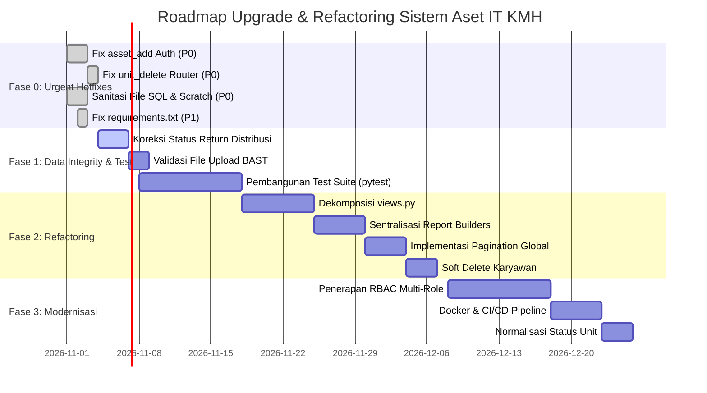

# 12 — Upgrade & Modernization Roadmap

**Tanggal Analisis:** 26 Oktober 2026  
**Prinsip Utama:** *Zero Downtime, Data Integrity First, Zero Business Disruption*  
**Dasar Penyusunan:** Hasil temuan audit statis kode, risiko keamanan terkonfirmasi, dan technical debt register.

---

## 1. Ikhtisar Fase Pengerjaan

Upgrade sistem dibagi menjadi 4 fase berurutan:
- **Fase 0 (Minggu 1):** *Urgent Hotfix & Security Patching* (Tanpa migrasi skema besar).
- **Fase 1 (Minggu 2-3):** *Core Data Integrity, Validation Hardening & Baseline Testing*.
- **Fase 2 (Minggu 4-6):** *Architectural Refactoring (Modularization & Pagination)*.
- **Fase 3 (Minggu 7-10):** *Feature Enhancements, RBAC & DevOps Modernization*.

---

## 2. Rincian Rencana per Fase

### FASE 0: Urgent Hotfix & Security Patching (Target: Hari ke 1 s/d 5)
Fase ini berfokus pada penutupan celah keamanan terkonfirmasi dan perbaikan bug jalur routing tanpa mengubah logika database.

#### Item 0.1 — Penambahan Autentikasi pada Endpoint Tambah Aset (`TD-001`)
- **Masalah:** Fungsi `asset_add` di `assets/views.py:192` tidak memiliki `@login_required`.
- **Kondisi Eksisting:** Permintaan POST tanpa session login tetap diproses dan membuat record di tabel `assets_asset`.
- **Target:** Endpoint menolak akses anonim dan me-redirect ke login.
- **Langkah Perbaikan:**
  ```python
  # assets/views.py
  @login_required
  def asset_add(request):
      # ... kode tetap sama ...
  ```
- **Kriteria Penerimaan:** Request `POST /aset/add/` tanpa cookie session mengembalikan HTTP 302 Redirect ke `/login/`.
- **Rencana Rollback:** Hapus kembali baris `@login_required` jika terjadi gangguan autentikasi darurat.

#### Item 0.2 — Perbaikan URL Router Penghapusan Unit Fisik (`TD-002`)
- **Masalah:** Fungsi `unit_delete` ada di `assets/views.py:410`, tetapi tidak didaftarkan pada `itam_core/urls.py`.
- **Kondisi Eksisting:** Fitur delete unit mati/tidak dapat diakses.
- **Target:** Rute terdaftar secara resmi dengan validasi POST method.
- **Langkah Perbaikan:**
  Tambahkan baris berikut pada `itam_core/urls.py`:
  ```python
  path('unit/<int:unit_id>/delete/', unit_delete, name='unit_delete'),
  ```
- **Kriteria Penerimaan:** Tombol hapus unit pada modal `asset_units.html` dapat mengirim request POST dan berhasil menghapus unit fisik serta mengurangi nilai `asset.qty`.

#### Item 0.3 — Sanitasi File Sensitif Repository (`TD-003`, `TD-024`)
- **Masalah:** File `database_lokal.sql`, `seed_karyawan.sql`, `scratch_urls_all.py`, dan `scratch_fix_views2.py` berada di repository.
- **Target:** File sensitif dihapus dari git tracking, `.gitignore` diperbarui.
- **Langkah Perbaikan:**
  Tambahkan aturan ke `.gitignore`:
  ```gitignore
  *.sql
  scratch_*.py
  error.log
  .env
  ```
  Jalankan perintah `git rm --cached database_lokal.sql seed_karyawan.sql scratch_*.py`.

#### Item 0.4 — Normalisasi Encoding Dependensi (`TD-007`)
- **Masalah:** Baris 15 file `requirements.txt` mengandung null-byte pada teks `openpyxl`.
- **Target:** File `requirements.txt` diformat ulang menjadi standar UTF-8 bersih.

---

### FASE 1: Core Data Integrity & Baseline Testing (Target: Minggu 2 s/d 3)
Fase ini memastikan integritas data penugasan unit dan memasang safety net berupa automated tests.

#### Item 1.1 — Koreksi Status Siklus Distribusi Pengembalian (`TD-008`)
- **Masalah:** Saat proses `distribusi_return`, kolom `returned_date` dan status `AssetAssignment` tidak diperbarui.
- **Target:** Record penugasan yang unitnya dikembalikan otomatis diubah statusnya menjadi `'dikembalikan'` dan tanggal kembali tercatat.
- **Langkah Perbaikan:** Pada `assets/views.py:654` (`distribusi_return`):
  Update status assignment aktif sebelumnya menjadi `dikembalikan` dan isi `returned_date = assigned_date`.
- **Kriteria Penerimaan:** Dalam laporan distribusi, status transaksi yang sudah kembali berstatus `'dikembalikan'`.

#### Item 1.2 — Penyeragaman Validasi Unggah Berkas BAST (`TD-006`)
- **Masalah:** Form serah terima dan mutasi tidak memvalidasi jenis file atau ukuran berkas.
- **Target:** Menerapkan fungsi validasi file upload terpusat (maks 5MB, format PDF/Word/Gambar).

#### Item 1.3 — Pembangunan Baseline Test Suite (`TD-004`)
- **Target:** Membuat test suite awal dengan target coverage minimal 60% mencakup:
  1. `test_auth.py`: Proteksi seluruh rute login.
  2. `test_asset_lifecycle.py`: CRUD aset, pembuatan unit, update kode unit saat kode aset berganti.
  3. `test_distribution.py`: Serah terima, mutasi, dan pengembalian unit secara atomic.
  4. `test_employee.py`: Validasi NIK dan proteksi hapus karyawan yang memegang aset.

---

### FASE 2: Architectural Refactoring (Target: Minggu 4 s/d 6)
Fase ini mengurai technical debt berat pada kode backend tanpa merusak antarmuka pengguna.

#### Item 2.1 — Dekomposisi "God File" `assets/views.py` (`TD-005`)
- **Target:** Memecah 3.056 baris kode menjadi modul-modul independen:
  ```
  assets/views/
  ├── __init__.py          # Export all view functions agar tidak merusak urls.py
  ├── auth_views.py        # login, logout, profile
  ├── dashboard_views.py   # dashboard
  ├── asset_views.py       # asset_list, asset_add, asset_edit, asset_delete
  ├── unit_views.py        # asset_units, unit_add, unit_edit, unit_delete, unit_status
  ├── distribution_views.py# handover, mutation, return, upload_doc
  ├── employee_views.py    # employee CRUD & detail
  ├── qr_views.py          # qr code generator & public detail
  ├── report_pdf.py        # Seluruh fungsi export PDF
  ├── report_excel.py      # Seluruh fungsi export Excel
  └── backup_views.py      # backup_database_view
  ```
- **Kriteria Penerimaan:** Seluruh test suite Fase 1 tetap lulus hijau (100% regression pass).

#### Item 2.2 — Sentralisasi Report Builder (ReportLab & openpyxl) (`TD-010`)
- **Target:** Membuat helper `BasePDFReport` dan `BaseExcelReport` untuk mengeliminasi ~1.500 baris duplikasi layout.

#### Item 2.3 — Implementasi Pagination Global (`TD-009`)
- **Target:** Menerapkan paginasi pada `asset_list`, `status_aset_list`, `distribusi_list`, dan `employee_list` dengan limit 25 item per halaman.

#### Item 2.4 — Migrasi Soft Delete Karyawan (`TD-011`)
- **Target:** Menambahkan field `is_active` pada `Employee` dan mengeliminasi ketergantungan pada parsing regex catatan string.

---

### FASE 3: Modernisasi & Fitur Lanjutan (Target: Minggu 7 s/d 10)
Fase peningkatan kapabilitas operasional dan kesiapan enterprise.

#### Item 3.1 — Penerapan Role-Based Access Control (RBAC) (`TD-016`)
- **Target:** Membedakan peran pengguna:
  1. **Super Admin IT:** Akses penuh konfigurasi sistem & backup database.
  2. **Teknisi IT / Operator:** Dapat melakukan CRUD aset, unit, dan distribusi serah terima.
  3. **Auditor / Management (Read-Only):** Hanya dapat melihat dashboard dan mengekspor laporan PDF/Excel.

#### Item 3.2 — Kontainerisasi Docker & CI/CD Pipeline (`TD-017`)
- **Target:** 
  1. `Dockerfile` berbasis multi-stage build (Node build + Python slim runtime).
  2. `docker-compose.yml` yang mencakup App Django, MySQL 8, dan Nginx Reverse Proxy.
  3. GitHub Actions workflow untuk otomatisasi running `pytest` dan linting pada setiap pull request.

#### Item 3.3 — Perbaikan Label Status Unit (`TD-012`)
- **Target:** Migrasi data nilai status dari choice value `'rusak'` menjadi `'maintenance'` (Dalam Pemeliharaan) agar konsisten antara frontend dan database.

---

## 3. Rangkuman Roadmap Diagram (Gantt Visual)


