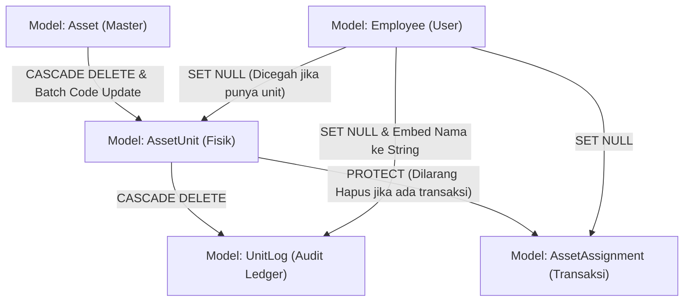

# 16 — Source Code Map & Responsibility Guide

**Tanggal Analisis:** 26 Oktober 2026  
**Status Verifikasi:** Terverifikasi via code indexing statis  

---

## 1. Peta Pohon Direktori & Komponen

```
manajemen-aset-it-ptkmh-master/
├── assets/                     # Django App Utama (Domain IT Asset Management)
│   ├── admin.py                # Konfigurasi antarmuka Django Admin (5 Model terdaftar)
│   ├── apps.py                 # AppConfig ('assets')
│   ├── models.py               # 6 Model Data Inti & Logic Sync Kode Unit
│   ├── tests.py                # Placeholder test (Kosong / 0% coverage)
│   ├── views.py                # Monolithic Views (3.056 baris - Seluruh Controller)
│   ├── management/
│   │   └── commands/
│   │       ├── seed_initial_data.py # Seeding kategori default ('Karyawan', 'Network')
│   │       └── setup_superuser.py   # Pembuatan superuser otomatis via ENV
│   └── migrations/             # 16 Migrasi database terurut
├── itam_core/                  # Konfigurasi Proyek Django
│   ├── asgi.py                 # ASGI entry point
│   ├── settings.py             # Global settings (DB MySQL, Auth, WhiteNoise, Logging)
│   ├── urls.py                 # Master routing (42 rute terdaftar)
│   └── wsgi.py                 # WSGI entry point untuk web server produksi
├── frontend/                   # Source Aset Frontend Vite
│   ├── main.js                 # Entrypoint script Vite
│   └── style.css               # Directive TailwindCSS (@tailwind base, etc.)
├── static/                     # Direktori Aset Statis
│   ├── dist/style.css          # CSS hasil kompilasi Tailwind final (~68 KB)
│   └── img/                    # Aset grafis & logo perusahaan
│       ├── kerinci_logo.png    # Logo resmi Kerinci Hydropower (dipakai di PDF & Header)
│       ├── it_all_role_logo.png# Logo divisi IT All Role (dipakai di PDF report)
│       └── main_logo.png       # Logo sidebar aplikasi web
├── templates/                  # Template HTML (Django DTL)
│   ├── base.html               # Master layout (Sidebar, Navbar, Toasts, Guide Modal)
│   ├── login.html              # Halaman autentikasi kredensial
│   ├── dashboard.html          # Halaman beranda ringkasan statistik
│   ├── asset_list.html         # Daftar master jenis aset (Tab Karyawan & Network)
│   ├── asset_units.html        # Daftar unit fisik per jenis aset
│   ├── distribusi_list.html    # Modul transaksi (Serah Terima, Mutasi, Return)
│   ├── status_aset_list.html   # Monitoring unit per status operasional
│   ├── employee_list.html      # Master data karyawan
│   ├── employee_detail.html    # Rincian aset yang dipegang seorang karyawan
│   ├── unit_history.html       # Timeline audit log pergerakan unit
│   ├── unit_public_detail.html # Halaman publik yang dibuka saat scan QR Code
│   ├── backup.html             # Antarmuka ekspor database JSON / SQL
│   └── 404.html                # Custom error page
├── media/                      # Upload runtime (Akan dibuat otomatis saat ada berkas)
│   └── bast_documents/         # Dokumen scan fisik BAST serah terima
├── .env.example                # Template konfigurasi variabel lingkungan
├── manage.py                   # CLI controller Django
├── package.json                # Dependensi frontend (Tailwind v3.4, Vite v5.4, HTMX v2.0)
└── requirements.txt            # Dependensi Python backend
```

---

## 2. Peta Fungsi Controller (`assets/views.py`)

File `assets/views.py` (3.056 baris) terbagi secara logis menjadi kelompok fungsi berikut:

| Kelompok Tanggung Jawab | Baris Awal – Akhir | Daftar Fungsi Utama | Model yang Terpengaruh | Tingkat Risiko Regresi Saat Diedit |
|---|---|---|---|---|
| **Dashboard Metrik** | L16 – L42 | `dashboard` | `AssetUnit`, `AssetAssignment` | Rendah |
| **Master Aset (SKU)** | L44 – L259 | `asset_list`, `asset_add`, `asset_edit`, `asset_delete` | `Asset`, `Category`, `AssetUnit` | **Sangat Tinggi** (Mengubah kode aset induk memicu auto-update ke seluruh unit anak) |
| **Unit Fisik Individual** | L260 – L441 | `asset_units`, `unit_add`, `unit_edit`, `unit_update_status`, `unit_delete`, `unit_history` | `AssetUnit`, `UnitLog`, `Employee` | **Tinggi** (Perubahan status unit memicu penulisan riwayat `UnitLog`) |
| **Status & Monitoring** | L442 – L489 | `status_aset_list` | `AssetUnit`, `Category` | Rendah |
| **Sirkulasi Distribusi** | L490 – L710 | `distribusi_list`, `distribusi_handover`, `distribusi_mutation`, `distribusi_return`, `distribusi_upload_doc` | `AssetAssignment`, `AssetUnit`, `UnitLog`, `Employee` | **Kritis** (Transaksi multi-tabel berbasis `@transaction.atomic`) |
| **Master Karyawan** | L711 – L801 | `employee_list`, `employee_detail`, `employee_create`, `employee_edit`, `employee_delete` | `Employee`, `AssetUnit`, `UnitLog` | **Tinggi** (Delete karyawan memodifikasi catatan log masa lalu via regex) |
| **QR Code & Publik** | L802 – L856 | `unit_qr_code`, `unit_public_detail` | `AssetUnit`, `UnitLog` | Sedang (Bergantung pada Pillow & font OS) |
| **Laporan Dokumen PDF** | L857 – L2440 | `asset_export_pdf`, `distribusi_export_pdf`, `status_aset_export_pdf`, `employee_export_pdf`, `employee_detail_export_pdf`, `unit_history_export_pdf`, `asset_units_export_pdf` | Read-only semua model | Sedang (Tinggi pada duplikasi kode ReportLab) |
| **Autentikasi & Akun** | L2441 – L2534 | `login_view`, `logout_view`, `custom_404_view`, `profile_view` | `User` | Sedang |
| **Pencadangan Database**| L2535 – L2596 | `backup_database_view` | Seluruh Database | **Kritis** (Menjalankan `dumpdata` dan subprocess `mysqldump`) |
| **Laporan Spreadsheet Excel** | L2597 – L3056 | `distribusi_export_excel`, `status_aset_export_excel`, `employee_export_excel`, `employee_detail_export_excel`, `unit_history_export_excel`, `asset_units_export_excel`, `asset_export_excel` | Read-only semua model | Rendah |

---

## 3. Matriks Ketergantungan Antar-Komponen (Cross-Dependency Risk)



### Zona Rawan Regresi Tinggi (*High-Impact Regression Zones*)
1. **Modifikasi `Asset.save()` (`assets/models.py:39-83`):**
   Metode ini memuat algoritma iterasi yang mengubah string `unit_code` dari seluruh unit yang berelasi jika `asset_code` berubah. Menyentuh fungsi ini berisiko merusak penomoran kode unit fisik di lapangan.
2. **Modifikasi Alur `distribusi_*` (`assets/views.py:576-687`):**
   Setiap fungsi distribusi memanipulasi minimal 3 tabel secara bersamaan (`AssetAssignment`, `AssetUnit`, dan `UnitLog`). Kegagalan salah satu instruksi dapat menyebabkan inkonsistensi state jika tidak dibungkus atomic block secara benar.
3. **Modifikasi `employee_delete` (`assets/views.py:784-800`):**
   Proses penghapusan karyawan menimpa field `UnitLog.notes` dengan format teks tertentu. Mengubah format ini akan merusak fungsi `unit_history` dan fungsi export riwayat yang membaca format tersebut dengan regex.
